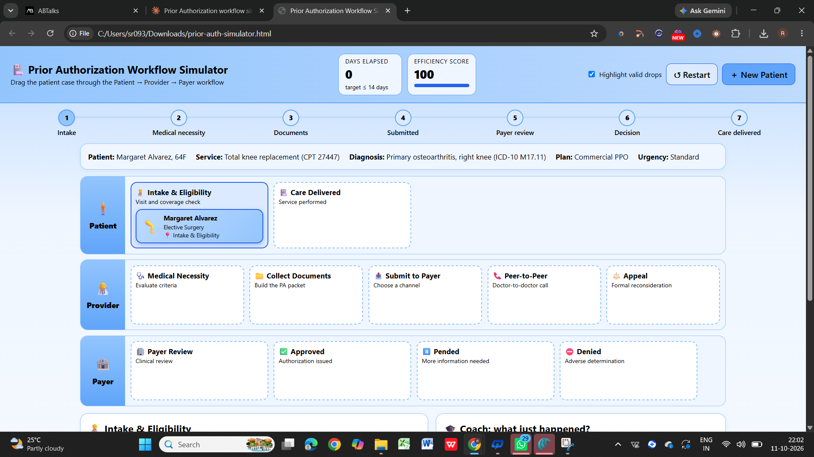
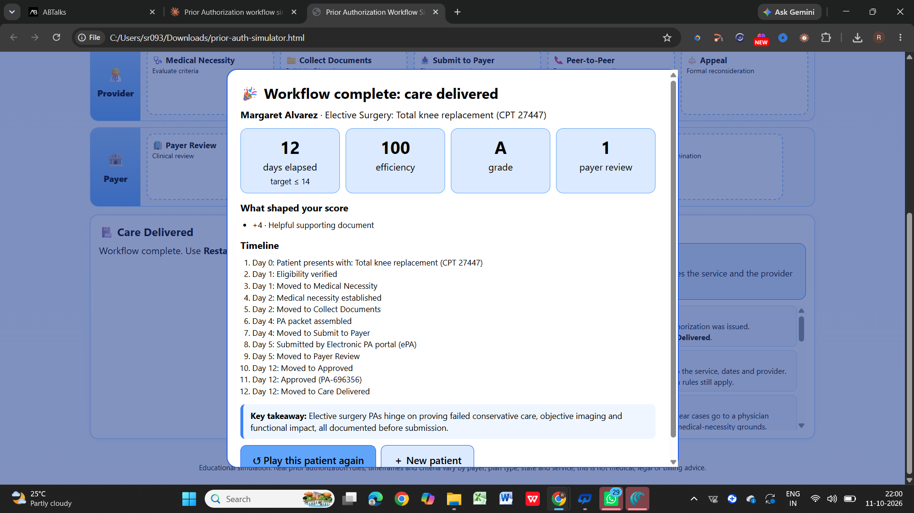

# Day 26 — Prior Authorization Workflow Simulator 🏥

## 📌 Overview
For Day 26 of the ABTalks 60 Days Claude Challenge, I built an interactive **Prior Authorization Workflow Simulator** using Claude.

The application simulates the US healthcare prior authorization process, helping users understand how patients, healthcare providers, and payers coordinate before a medical service is approved.

## ✨ Key Features
- Three workflow lanes: Patient, Provider, and Payer.
- Four patient scenarios covering elective surgery, MRI, specialty medication, and inpatient admission.
- Interactive drag-and-drop workflow.
- Medical necessity evaluation.
- Prior Authorization document collection and submission.
- Payer outcomes including Approval, Pend, Denial, Appeal, and Peer-to-Peer Review.
- Educational explanations throughout the workflow.
- Progress tracker, elapsed days counter, and efficiency score.
- Approval celebration animation and final workflow summary.
- Restart and New Patient controls.
- Responsive interface built with HTML, CSS, and vanilla JavaScript.

## 🛠️ Technologies Used
- HTML
- CSS
- Vanilla JavaScript
- Claude for application generation

## 📂 Project Files
- `prior-auth-simulator.html` — Standalone interactive simulator.
- `day26_dashboard.png` — Screenshot of the main workflow dashboard.
- `day26_verdict.png` — Screenshot of the completed workflow result.

## 📸 1. Workflow Dashboard

## 📸 2. Completed Workflow Result

## 🧠 What I Learned
- How to model a complex healthcare workflow as an interactive simulation.
- How drag-and-drop interactions can make process-based learning more engaging.
- How medical necessity, supporting documentation, and payer review fit into prior authorization.
- How to track workflow progress, elapsed time, and efficiency.
- How to build a self-contained browser application without external dependencies.

## ⚠️ Implementation Note
This is an educational simulation. Healthcare authorization rules, timelines, and requirements vary by payer, plan, and jurisdiction. The simulator does not replace actual payer policies or professional medical and billing guidance.

## 🚀 Outcome
Created an interactive learning experience that demonstrates the major stages of the prior authorization process and provides feedback on workflow decisions.

---

**Challenge:** ABTalks 60 Days Claude Challenge  
**Day:** 26  
**Project:** Prior Authorization Workflow Simulator
