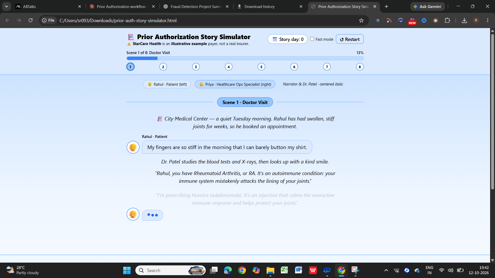
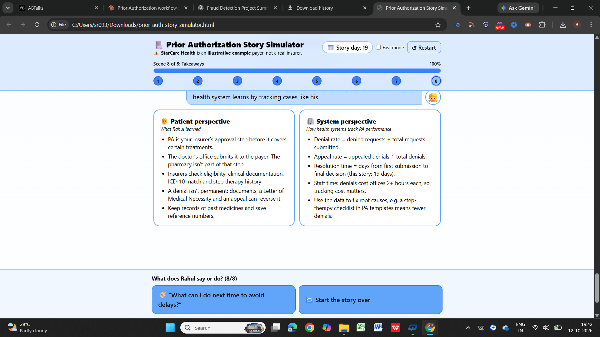

# Day 27 — Prior Authorization Story Simulator

Built an interactive healthcare education simulator for the **ABTalks 60 Days Claude Challenge**.

## 📌 Project Overview

The Prior Authorization Story Simulator follows Rahul, a patient diagnosed with Rheumatoid Arthritis, and Priya, a healthcare operations specialist, as they navigate the insurance approval process.

The story covers the journey from a doctor's prescription through insurance review, denial, appeal, and final approval.

## ✨ Features

- 8 interactive story scenes with user choices
- Patient and healthcare operations specialist dialogue
- Prior authorization workflow: Provider → PA Request → Payer
- Eligibility, clinical documentation, ICD-10 diagnosis matching, and step therapy explanations
- Simulated denial and appeal process
- Letter of Medical Necessity and supporting documentation
- Approval card with a reference number
- Progress bar, scene indicators, Fast Mode, and Restart controls
- Patient takeaways and healthcare system performance metrics

## 🛠️ Tech Stack

- HTML5
- Tailwind CSS
- Vanilla JavaScript

## 📸 Screenshots

### 1. Interactive Story Dashboard

### 2. Final Takeaways — Patient and System Perspectives

## 💡 Key Learnings

- Understood how prior authorization connects healthcare providers and insurance payers.
- Learned why accurate clinical documentation and step therapy history matter.
- Explored how appeals can address missing information in a denied request.
- Understood healthcare performance metrics such as denial rate, appeal rate, and resolution time.
- Practiced building interactive, multi-scene web experiences using JavaScript.

## ⚠️ Educational Disclaimer

StarCare Health is an illustrative example payer, not a real insurer. The permanent approval shown in this simulation is a story-specific rule; actual insurance approvals and renewal requirements vary by plan.

## 🚀 Challenge

**ABTalks — 60 Days Claude Challenge | Day 27**

An interactive simulation designed to make the prior authorization process easier to understand.
