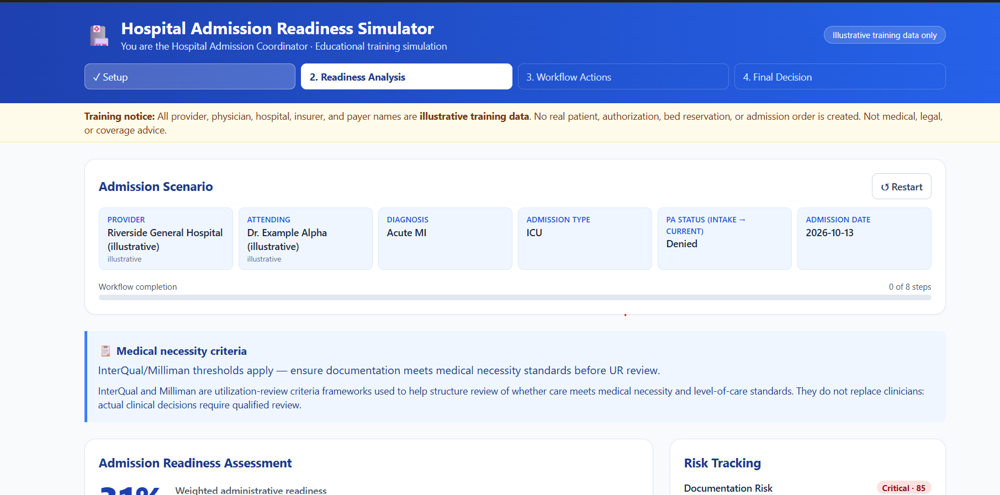
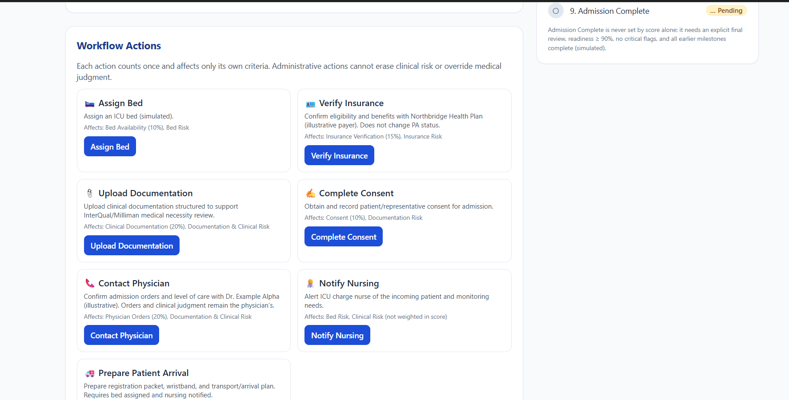
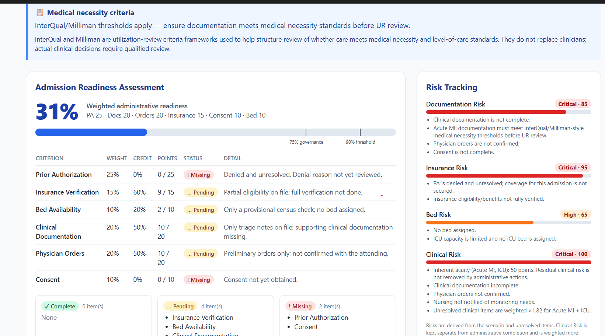

# Day 28 — Hospital Admission Readiness Simulator 🏥

An interactive healthcare operations simulation built for the **ABTalks 60 Days Claude Challenge**.

## 📌 Project Overview

The Hospital Admission Readiness Simulator puts the user in the role of a Hospital Admission Coordinator. It demonstrates how prior authorization, insurance verification, clinical documentation, physician orders, consent, and bed availability affect admission readiness.

The simulation helps users understand admission workflows, identify operational risks, and determine what actions are still required before reviewing a final readiness decision.

## ✨ Features

- Task-first admission setup form
- Multiple diagnoses and admission types
- Prior Authorization status management
- Dynamic admission readiness scoring
- Workflow actions and progress tracking
- Prior Authorization denial and appeal scenarios
- Documentation, insurance, bed, and clinical risk tracking
- Care coordination roles for physicians, case managers, nursing, utilization review, and discharge planning
- Governance Snapshot with educational benchmark estimates
- Final decision summary with missing items and required actions
- Restart functionality for testing different scenarios

## 🛠️ Tech Stack

- HTML5
- Tailwind CSS via CDN
- Vanilla JavaScript

## 📸 Screenshots

### 1. Admission Readiness Dashboard

The initial analysis displays the readiness score, authorization status, outstanding requirements, and clinical risk indicators.

### 2. Workflow Actions and Prior Authorization

This view demonstrates workflow progress, authorization follow-up, denial resolution, appeal actions, and outstanding admission requirements.

### 3. Final Admission Decision

The final decision summarizes readiness, completed actions, remaining risks, and next steps. The simulator uses its configured readiness threshold while keeping unresolved critical risks visible.

## 💡 Key Learnings

- Understood the major administrative steps involved in hospital admission readiness.
- Explored how prior authorization and insurance verification affect admission workflows.
- Learned how missing documentation can contribute to authorization delays and denials.
- Practiced modeling workflow states, weighted scoring, and risk tracking.
- Explored the roles of utilization review and care coordination.
- Built an interactive, browser-based healthcare simulation using JavaScript.

## ⚠️ Educational Disclaimer

This application is an educational training simulation. Provider, physician, hospital, insurer, and payer names are illustrative
