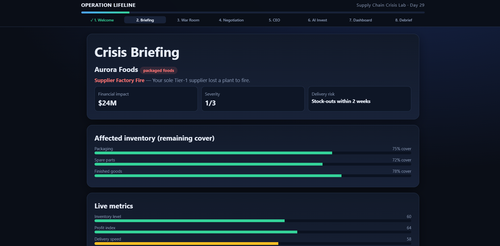
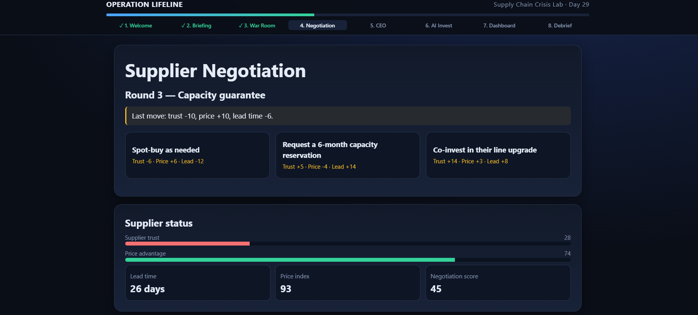
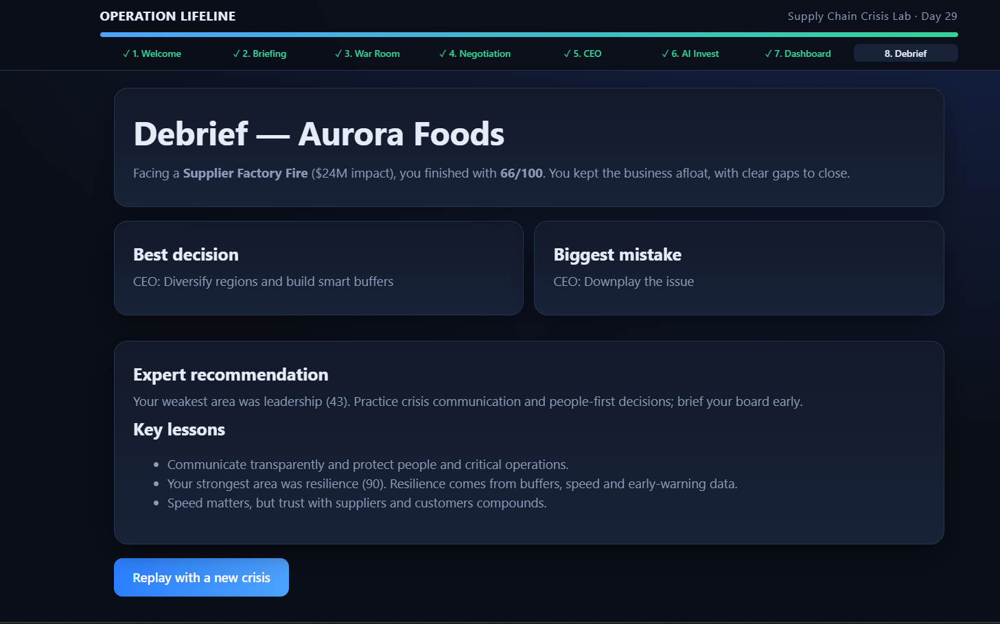

# Day 29 — Operation Lifeline: Supply Chain Crisis Lab

**ABTalks 60 Days Claude Challenge**

## 🚨 Overview

Operation Lifeline is an interactive supply chain crisis simulation where players act as business leaders and make strategic decisions to manage disruptions, negotiate with suppliers, respond to CEO challenges, and invest in AI solutions.

The goal is to balance operational resilience, financial performance, customer satisfaction, and risk management under pressure.

## 🎯 Key Features

- **Crisis Briefing:** Analyze the company, disruption, financial impact, and affected inventory.
- **War Room:** Select strategic actions to respond to the crisis.
- **Supplier Negotiation:** Make decisions across multiple negotiation rounds.
- **CEO Challenge:** Answer leadership and crisis-management questions.
- **AI Investment:** Choose AI investments to strengthen future resilience.
- **Final Dashboard:** Review performance metrics and overall results.
- **Debrief:** Understand key decisions, mistakes, and recommendations.

## 📸 Project Screenshots

### 1. Crisis Briefing
The initial briefing introduces the fictional company, supply chain disruption, financial impact, inventory coverage, and live business metrics.

### 2. Strategic Decisions
The decision-making interface challenges players to select actions and investments while balancing operational priorities, budget, and business risks.

### 3. Final Verdict & Performance Dashboard
The final dashboard and debrief summarize the simulation results, performance scores, important decisions, and recommendations for improvement.

## 🛠️ Technology Stack

- HTML
- CSS
- Vanilla JavaScript

## 💡 What I Learned

- Making decisions under pressure and uncertainty.
- Understanding supply chain risks and operational resilience.
- Balancing budget, profitability, delivery speed, and customer satisfaction.
- Exploring how AI investments can support business continuity.
- Building an interactive browser-based simulation using HTML, CSS, and JavaScript.

## ▶️ How to Run

1. Download or clone this repository.
2. Open `operation_lifeline.html` in a web browser.
3. Start the simulation and complete all stages.

The application is designed to run locally without a backend or external libraries.

---

**Day 29 complete — building, experimenting, and learning one challenge at a time.**

#ABTalks #60DaysClaudeChallenge #ClaudeAI #SupplyChainManagement #ArtificialIntelligence #JavaScript #LearningByBuilding
