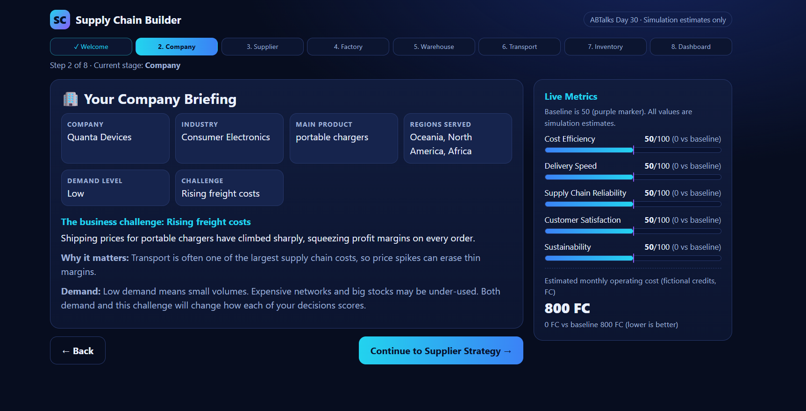
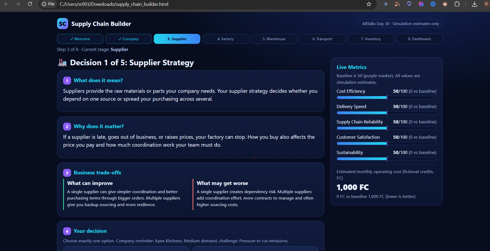
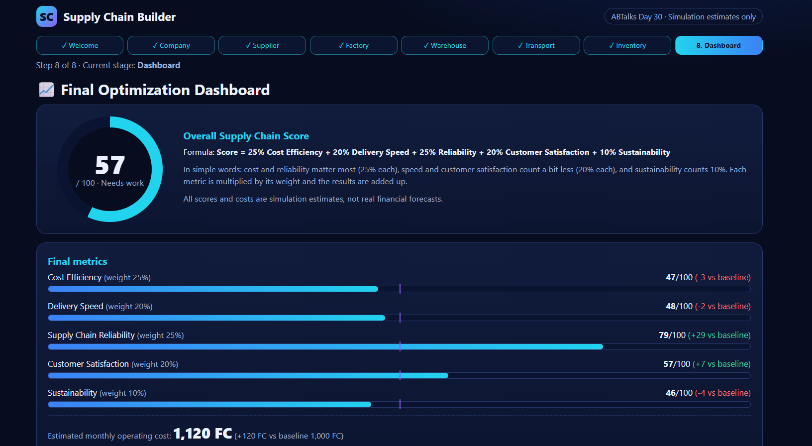

# Day 30 — Supply Chain Builder

## Overview
An interactive AI-powered Supply Chain Builder that simulates business decisions across suppliers, factories, warehouses, transportation, and inventory.

The application helps users understand how operational decisions affect cost efficiency, delivery speed, reliability, customer satisfaction, and sustainability.

## Features
- Company briefing and business scenario generation
- Supplier selection and factory planning
- Warehouse and transportation decisions
- Inventory strategy simulation
- Live performance metrics and overall scoring
- Final dashboard with recommendations
- Replay functionality for trying a new scenario

## Screenshots

### 1. Company Briefing

### 2. Supply Chain Decisions

### 3. Final Dashboard

## Technologies Used
- HTML
- CSS
- JavaScript
- React
- Babel

## What I Learned
This project helped me explore interactive UI development, decision-based simulations, dynamic performance metrics, and presenting business insights through a dashboard.

## Challenge
**ABTalks — 60 Days Claude Challenge | Day 30**

Built as part of my ongoing journey of learning, experimenting, and building projects with AI assistance.
