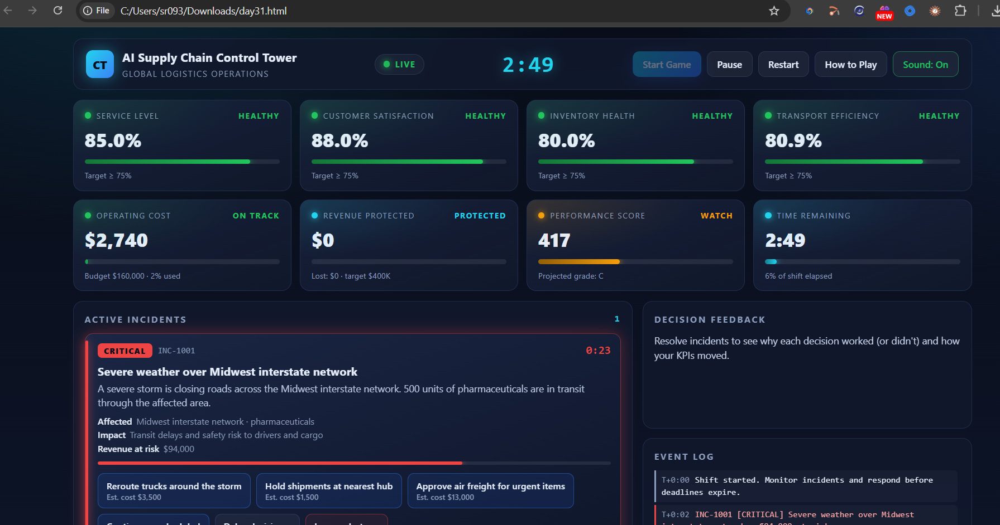
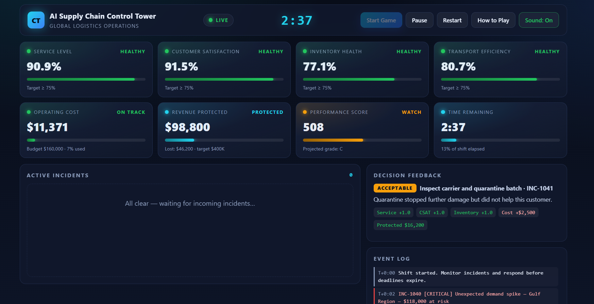
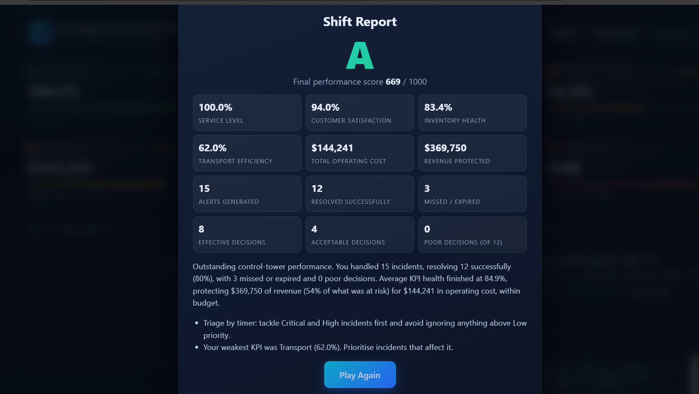

# Day 31 — AI Supply Chain Control Tower 🚚

## 📌 Overview

Built an interactive Supply Chain Control Tower game using Claude for the ABTalks 60 Days Claude Challenge.

The game simulates supply chain disruptions and challenges players to make decisions while managing operational KPIs, costs, and customer satisfaction.

## 🖥️ Dashboard Preview

## 🎮 Gameplay — Alerts and Decisions

## 🏆 Final Verdict

## ✨ Features

- Live KPI dashboard
- Dynamic supply chain incidents
- Decision-based outcomes
- Three-minute countdown challenge
- Live activity and event log
- Pause, resume, and restart controls
- Final score, grade, and performance report
- Responsive user interface

## 🛠️ Tech Stack

- HTML5
- CSS3
- Vanilla JavaScript

## 🧠 Key Learnings

- JavaScript event handling and state management
- Countdown timers and game-state control
- Dynamic KPI updates and decision logic
- Dashboard design and responsive layouts
- Using Claude to build an interactive application

## 🚀 How to Run

1. Download `day31.html`.
2. Open it in a modern web browser.
3. Click **Start Shift** and play the game.

---

**Challenge:** ABTalks — 60 Days Claude Challenge  
**Day:** 31  
**Project:** AI Supply Chain Control Tower
