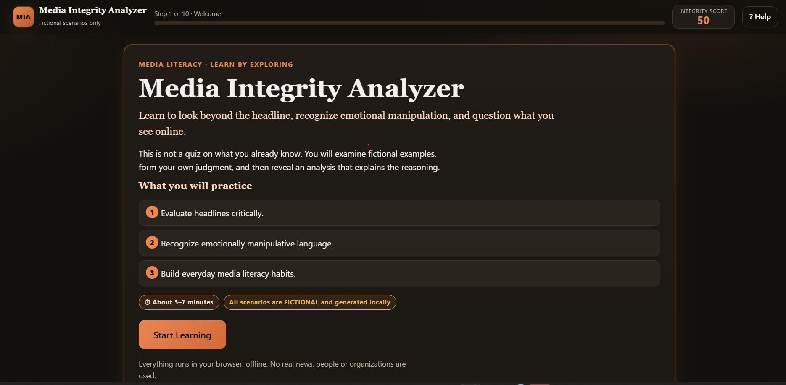
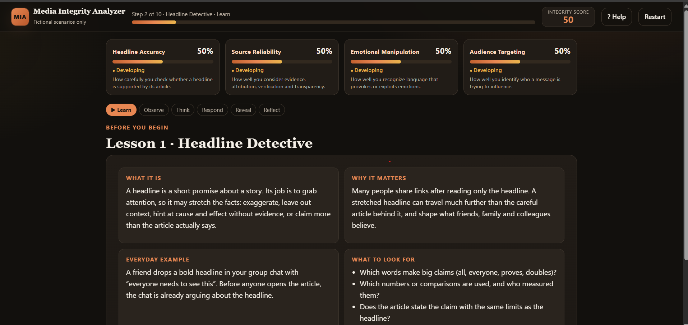
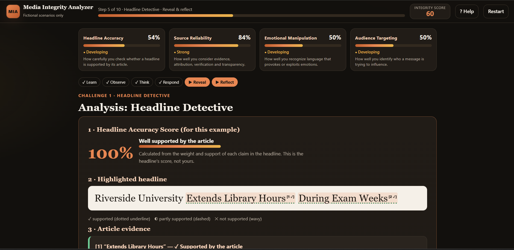

# Day 33 — Media Integrity Analyzer 📰

**ABTalks 60 Days Claude Challenge**

## 📌 Overview

Media Integrity Analyzer is an interactive, offline web application built with Claude to help users evaluate headlines, identify misleading claims, and develop critical media literacy.

The project encourages critical thinking by comparing headlines with article evidence and helping users recognize misleading framing before sharing information.

## ✨ Features

- 📰 **Headline Detective:** Compare headlines with their corresponding articles.
- 🔍 **Misleading Phrase Detection:** Identify claims that may misrepresent the article.
- 📊 **Accuracy Scoring:** Evaluate headline accuracy using weighted claims.
- ✍️ **Fair Headline Rewrites:** Explore more accurate and balanced alternatives.
- 📈 **Live Metrics:** Track headline integrity and related indicators.
- 🎯 **Final Dashboard:** Review results, key insights, and practical takeaways.
- 🔄 **Replay Experience:** Explore new scenarios and practice critical reading.
- 💻 **Offline Functionality:** Runs directly in a browser without external APIs or libraries.
- 🎨 **Claude Orange Theme:** A modern, responsive interface with interactive elements.

## 📸 Screenshots

### 🏠 Home Screen

### 📰 Headline Detective

### 📊 Final Dashboard

## 🛠️ Technologies Used

- HTML5
- CSS3
- Vanilla JavaScript
- Claude AI

## 🎯 Learning Outcomes

- Analyze headlines against supporting article evidence.
- Recognize misleading framing and exaggerated claims.
- Develop critical thinking and media literacy.
- Understand how evidence-based feedback supports learning.
- Build a standalone, responsive web application using Claude.

## 🚀 How to Run

1. Download `day33.html` from this repository.
2. Open the file in a modern web browser.
3. Explore the headline-analysis scenarios.
4. Review the results, metrics, and final dashboard.

No installation or external libraries are required.

## 💡 Key Takeaway

**Never judge a story by its headline alone. Read the evidence, question the framing, and think critically before sharing information.**

---

**Built as part of the ABTalks 60 Days Claude Challenge.**

#ABTalks #60DaysClaudeChallenge #ClaudeAI #MediaLiteracy #CriticalThinking #WebDevelopment #JavaScript #BuildInPublic
