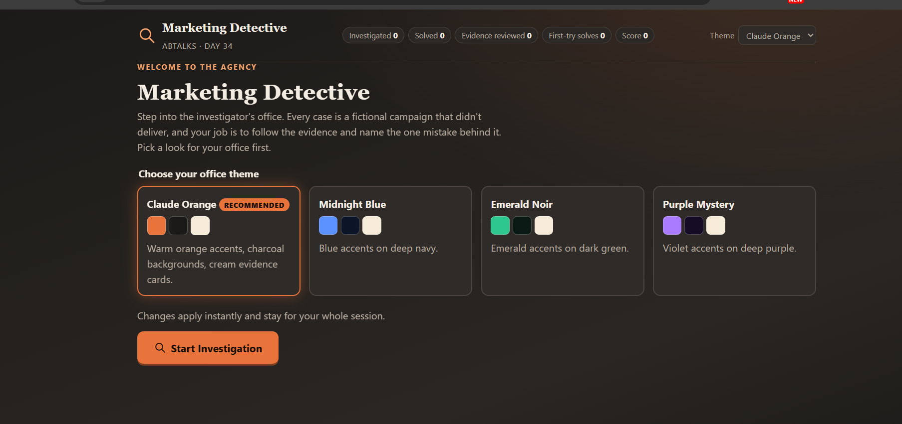
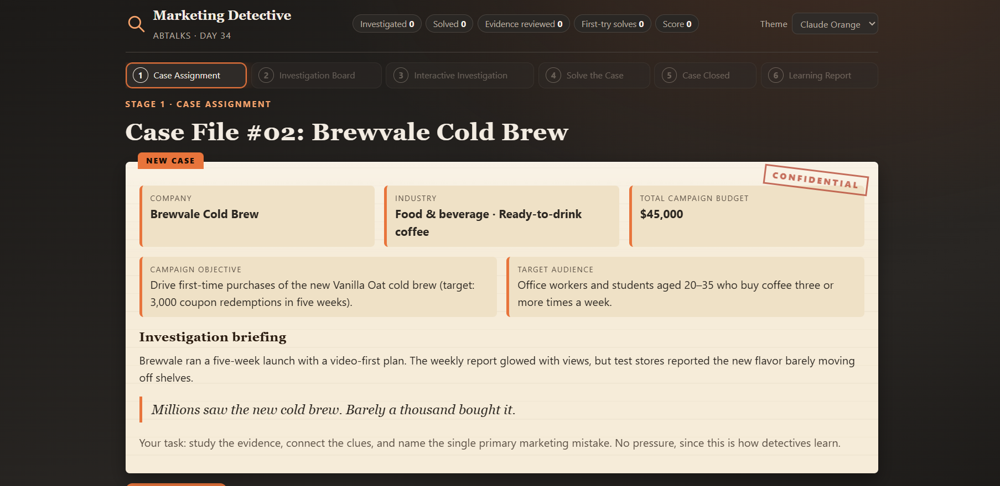
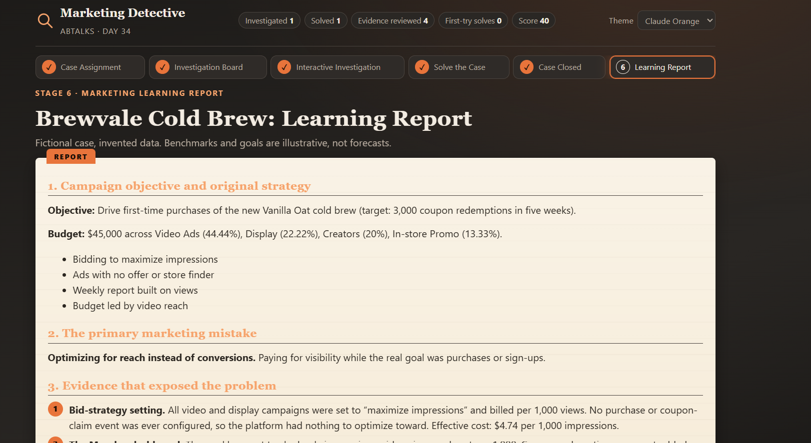

# 🕵️ Day 34 — Marketing Detective

**ABTalks 60 Days Claude Challenge**

Marketing Detective is an interactive, detective-themed learning game where I investigate fictional marketing campaigns, analyze campaign metrics, identify mistakes, and learn how to improve marketing performance.

## 🎯 Project Overview

The goal is to think like a marketing analyst and solve campaign failures using evidence instead of guesswork.

### ✨ Key Features

- 🎨 **4 Theme Options:** Claude Orange, Midnight Blue, Emerald Noir, and Purple Mystery.
- 🔍 **Interactive Investigations:** Analyze fictional marketing campaigns and their performance.
- 📊 **Campaign Analytics:** Explore reach, CTR, engagement, conversions, sales, and budget.
- 🧩 **Evidence Board:** Review clues and connect evidence to identify the main marketing mistake.
- 🏆 **Case Closed:** Solve cases and receive feedback on the investigation.
- 📚 **Learning Report:** Review mistakes, explanations, and actionable marketing improvements.
- 🔄 **Replay Mode:** Investigate new cases and track progress.

## 🖥️ Screenshots

### 1. Home Screen & Theme Selection

Choose the visual theme before starting the investigation.

### 2. Investigation Board

Examine campaign performance, review the available evidence, and investigate the clues to discover what went wrong.

### 3. Case Closed & Learning Report

Review the final verdict, understand the mistake behind the campaign's failure, and learn how the strategy could be improved.

## 🛠️ Built With

- HTML5
- CSS3
- JavaScript

## 💡 What I Learned

This project helped me explore how interactive web applications can turn marketing concepts into a hands-on learning experience. It also reinforced the importance of analyzing metrics, connecting evidence, identifying root causes, and making data-driven decisions.

## 🚀 Challenge

**Day 34 of the #60DaysClaudeChallenge**

Built with Claude as part of my journey to experiment, learn, and build something new every day.

#ABTalksOnAI #60DaysClaudeChallenge #ClaudeAI #MarketingAnalytics #WebDevelopment
