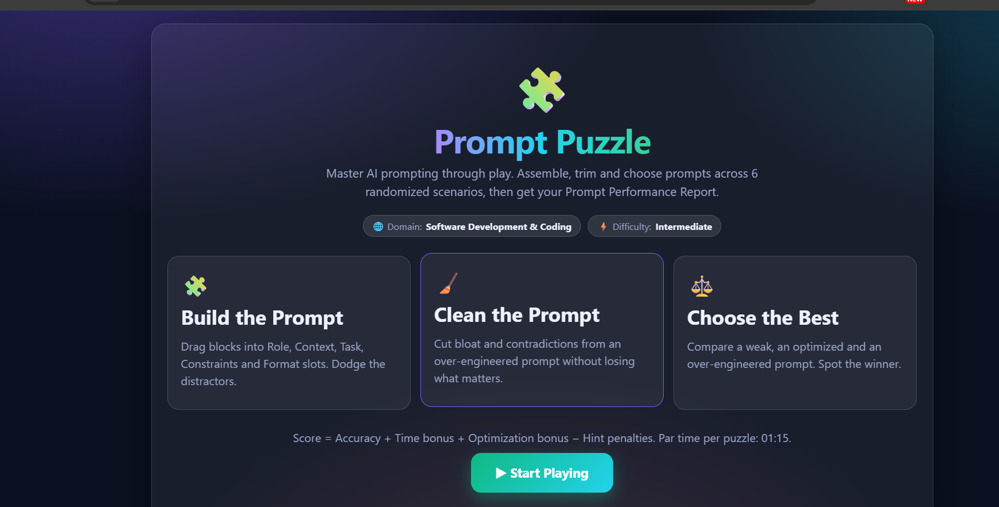
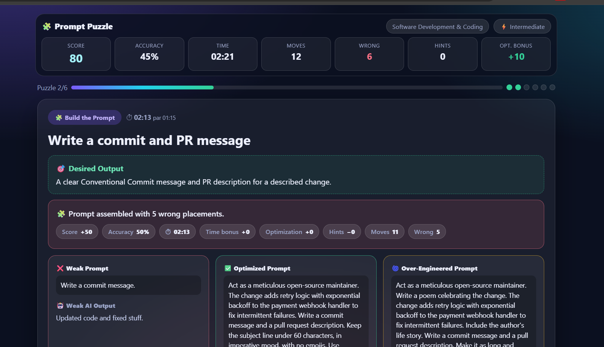
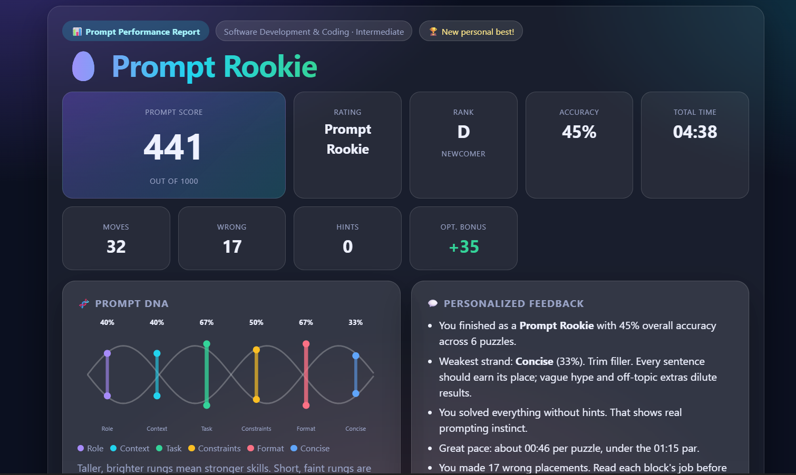

# 🧩 Day 35 — Prompt Puzzle
### Master AI Prompting Through Play

For Day 35 of the **ABTalks 60 Days Claude Challenge**, I built **Prompt Puzzle** — an interactive, single-file HTML game designed to help users improve their AI prompting skills through hands-on challenges.

The app focuses on **Software Development & Coding** at the Intermediate difficulty level.

## 📸 Screenshots

### 1. Home Screen

### 2. Prompt Challenge

### 3. Performance Report

## ✨ Features

- 🎯 Randomized coding scenarios to practice prompt engineering.
- 🧩 Three challenge types: Build the Prompt, Clean the Prompt, and Choose the Best Prompt.
- 📊 Live scoring with accuracy, time, moves, wrong placements, hints, and optimization bonus.
- 🧠 Prompt principles and comparisons between weak, optimized, and over-engineered prompts.
- 🏆 Final performance report with score, rating, rank, Prompt DNA visualization, and personalized feedback.
- 🔄 Replay with new randomized scenarios.
- 🎨 Premium dark UI with interactive elements and progress indicators.
- 💻 Single-file HTML application designed to work offline without external dependencies.

## 🛠️ Built With

- HTML5
- CSS3
- JavaScript

## 💡 What I Learned

This challenge helped me explore how prompt engineering can be taught through interactive gameplay, immediate feedback, and practical coding scenarios. It also gave me an opportunity to work on UI design, JavaScript game logic, and performance tracking in a standalone web application.

**Challenge:** ABTalks — 60 Days Claude Challenge  
**Day:** 35 — Prompt Puzzle

#ABTalks #ABTalksOnAI #60DaysClaudeChallenge #ClaudeAI #PromptEngineering #WebDevelopment #JavaScript
