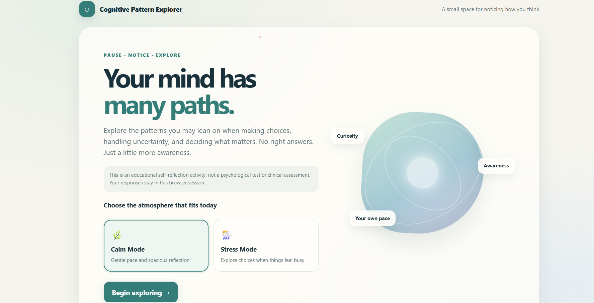
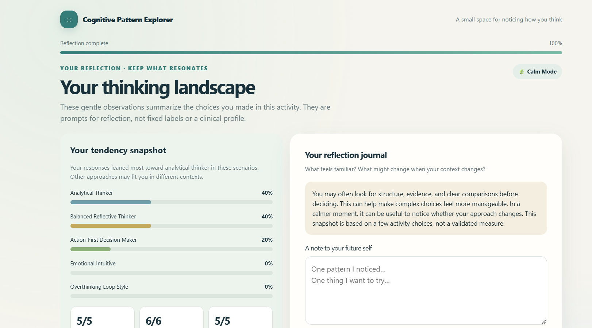
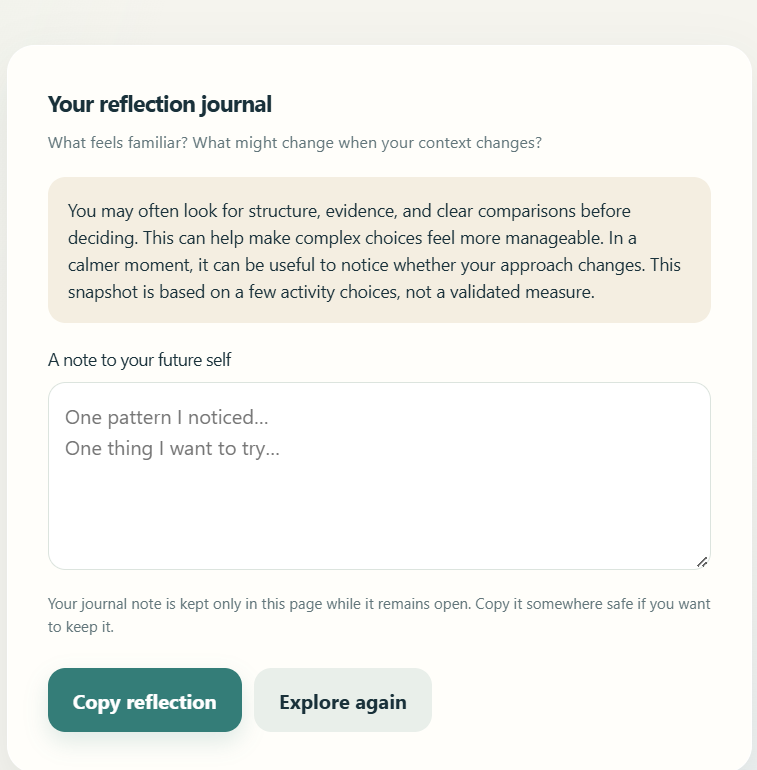

# 🧠 Day 36 — Cognitive Pattern Explorer

### Explore How You Think

For Day 36 of the **ABTalks 60 Days Claude Challenge**, I used Claude to create *Cognitive Pattern Explorer* — an interactive, psychology-inspired self-reflection experience built with HTML, CSS, and vanilla JavaScript.

## 📸 Screenshots

### Home Screen

### Thinking Profile

### Reflection Journal

## ✨ Features

- 🌿 Calm Mode and Stress Mode
- 🧠 Interactive scenarios to explore thinking tendencies
- 🃏 Drag-and-drop priority cards
- 🗺️ Interactive thinking timeline
- 📊 Personalized reflection with percentage breakdowns
- ✍️ Reflection journal and personal insights
- 📱 Responsive interface with accessibility considerations
- 💻 Single-file HTML application designed to work offline

## 🛠️ Tech Stack

- HTML5
- CSS3
- Vanilla JavaScript

## 💡 Key Learnings

This challenge explored how interactive scenarios can encourage self-reflection and help people notice different approaches to decision-making.

It also provided practice in building interactive interfaces, handling user responses, implementing drag-and-drop interactions, and creating a responsive standalone web application.

*This is an educational self-reflection experience, not a psychological test or clinical assessment.*

**Challenge:** ABTalks — 60 Days Claude Challenge  
**Day:** 36

#ABTalks #ABTalksOnAI #60DaysClaudeChallenge #ClaudeAI #JavaScript #WebDevelopment #SelfReflection
