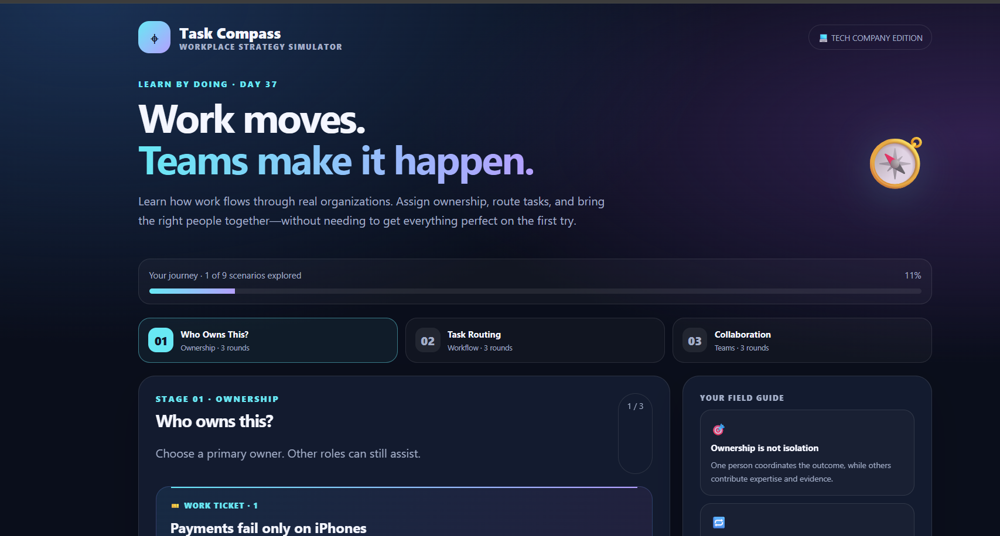
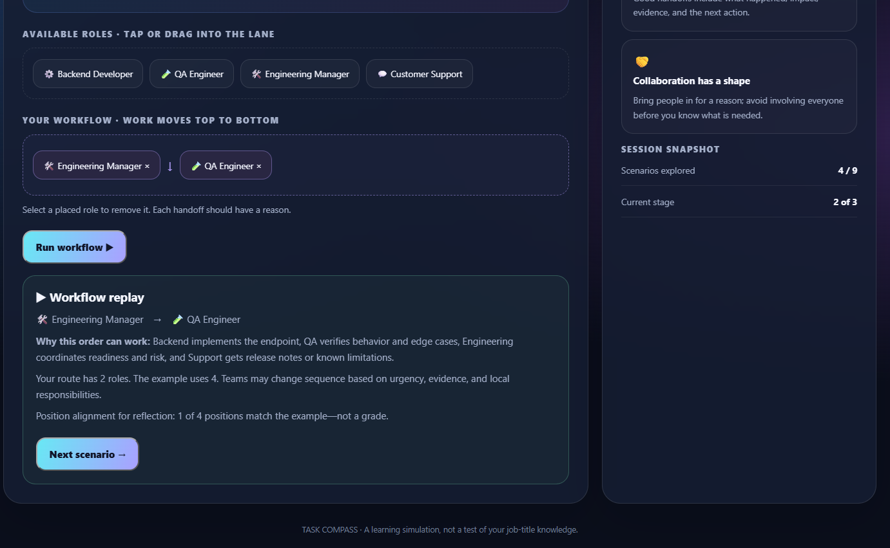
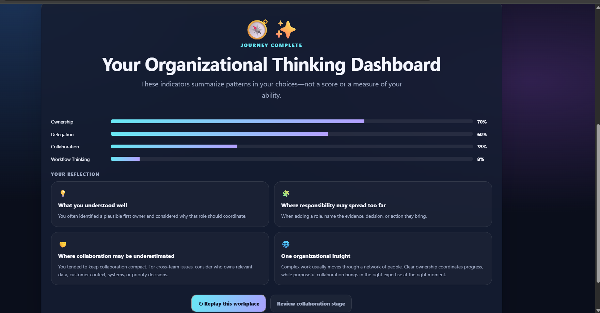

# 🧭 Day 37 — Task Compass

### Learn How Work Flows Through Real Organizations

For Day 37 of the **ABTalks 60 Days Claude Challenge**, I built **Task Compass**, an interactive workplace management simulation designed to explore how work flows through a tech company.

The project focuses on ownership, delegation, workflow thinking, and collaboration through realistic workplace scenarios rather than traditional quizzes.

## 📸 Screenshots

### 1. Home

### 2. Gameplay

### 3. Organizational Thinking Dashboard

## ✨ Features

- 🎯 **Who Owns This?** — Understand task ownership and responsibility.
- 🔀 **Task Routing** — Build workflows by arranging roles in the right order.
- 🤝 **Collaboration Challenge** — Assign primary owners and supporting teams.
- 📊 **Organizational Thinking Dashboard** — Review understanding across key categories.
- 💡 **Final Reflection** — Explore insights about responsibility and teamwork.
- 🎮 Interactive role cards, progress tracking, and animated feedback.
- 🌙 Modern dark UI with glassmorphism.
- 💻 Single-file application designed to work offline.

## 🛠️ Tech Stack

- HTML5
- CSS3
- Vanilla JavaScript

## 📚 Key Learnings

- **Ownership:** Clear responsibility helps tasks move forward.
- **Delegation:** Assigning work to appropriate roles improves coordination.
- **Workflow Thinking:** Tasks often pass through multiple stages before completion.
- **Collaboration:** Complex problems commonly require communication across teams.

## 💭 My Takeaway

Building Task Compass helped me explore how technical teams coordinate to solve real-world problems. Successful organizations rely not only on individual contributions but also on clear communication, shared responsibility, and effective workflows.

*Task Compass is an educational management simulation. Real responsibilities and workflows vary between organizations.*

---

**Challenge:** ABTalks — 60 Days Claude Challenge  
**Day:** 37  
**Project:** Task Compass

#ABTalks #ABTalksOnAI #60DaysClaudeChallenge #ClaudeAI #HTML #CSS #JavaScript #WebDevelopment #ManagementSimulation
