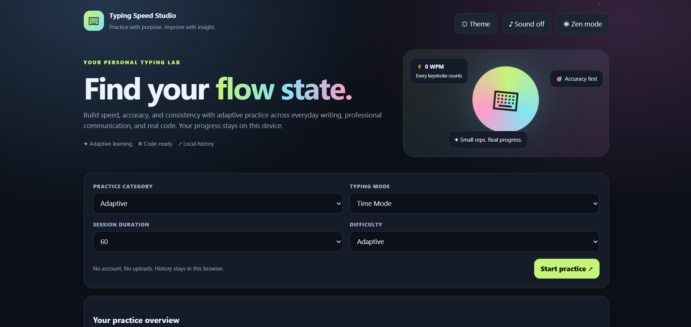
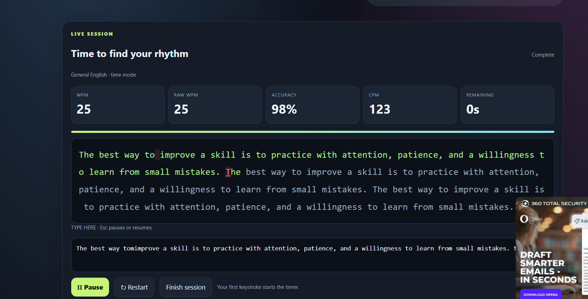
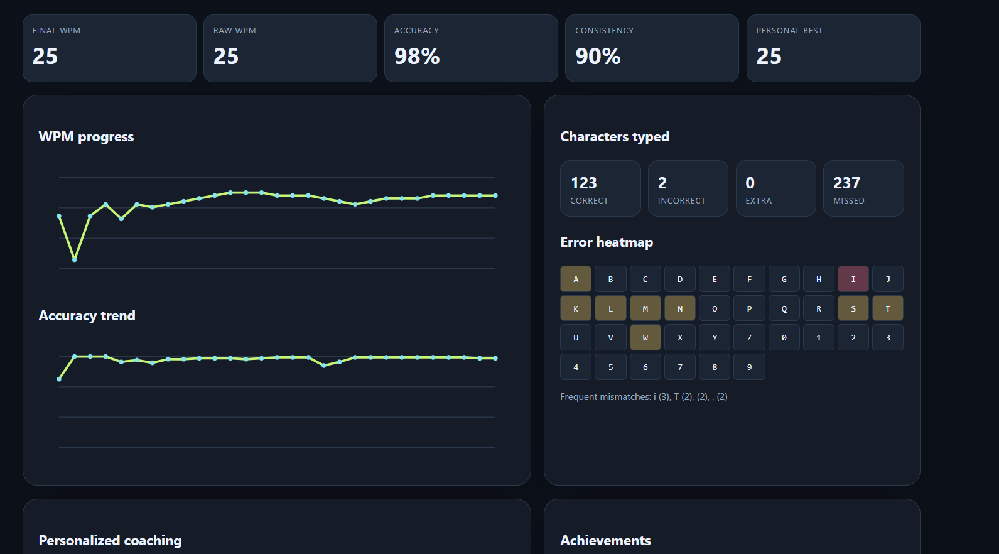

# Day 38 — Typing Speed Studio ⌨️

## 🚀 Overview
Built **Typing Speed Studio**, a premium typing practice web app designed to improve typing speed, accuracy, consistency, and coding fluency.

The project focuses on creating a personalized typing experience with multiple practice modes, programming exercises, live performance tracking, and progress analytics.

## ✨ Features

- **Multiple Typing Modes:** Time-based, word-count, quotes, custom text, and Focus & Zen.
- **Programming Practice:** Practice typing code in C++, Java, Python, JavaScript, SQL, HTML, and CSS.
- **Adaptive Difficulty:** Adjust practice difficulty based on performance.
- **Live Statistics:** Track WPM, Raw WPM, CPM, accuracy, mistakes, and streaks.
- **Analytics Dashboard:** Review typing performance, consistency, and common errors.
- **Session History:** Save practice sessions and personal bests locally.
- **Gamification:** Unlock achievements, badges, and milestones.
- **Customization:** Explore themes, fonts, sounds, and animations.
- **Accessibility & Controls:** Pause, resume, restart, and use keyboard shortcuts.
- **Personalized Coaching:** Identify weak keys and get suggestions for improvement.

## 📸 Screenshots

### 1. Home Screen
Explore typing categories, practice modes, and session options.

### 2. Live Typing Session
Practice typing while monitoring speed, accuracy, time, and progress.

### 3. Analytics Dashboard
Review typing performance, progress charts, common errors, achievements, and coaching insights.

## 🛠️ Tech Stack

- HTML
- CSS
- JavaScript
- Browser Local Storage
- SVG / Canvas visualizations (where applicable)

## 🎯 What I Learned

- Building interactive interfaces using vanilla JavaScript.
- Calculating live typing metrics such as WPM and accuracy.
- Managing user preferences and session history locally.
- Designing analytics and progress-tracking experiences.
- Creating a responsive, keyboard-friendly user interface.

## 💡 Challenge Takeaway

This project helped me explore how a simple typing test can become a more personalized learning tool through real-time feedback, analytics, and adaptive practice.

**Day 38 of the 60 Days Claude Challenge — learning by building, one project at a time.**

#60DaysClaudeChallenge #ABTalksOnAI #WebDevelopment #JavaScript #ClaudeAI
