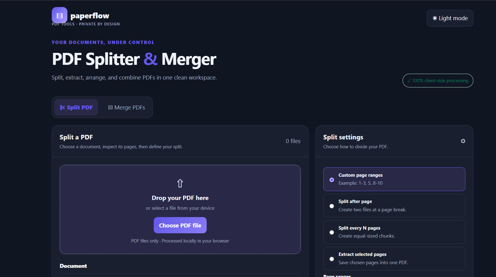
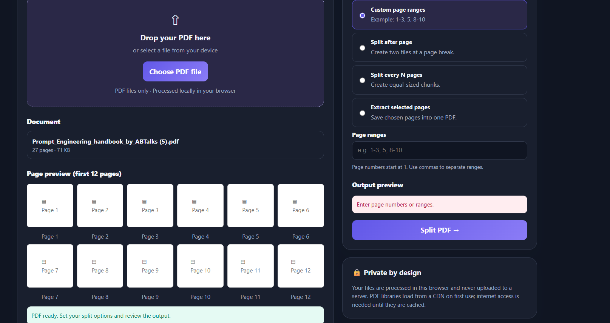
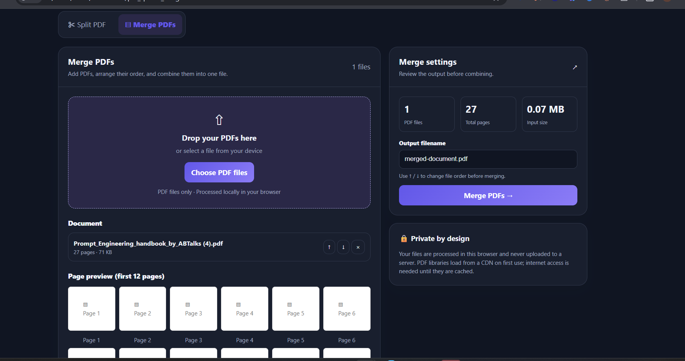

# Day 39 — PDF Splitter & Merger 📄

## 🚀 Overview

Built **PDF Splitter & Merger**, a browser-based PDF utility designed to split, extract, preview, and merge PDF documents through a clean, modern interface.

The goal was to create a convenient document-processing tool that keeps files on the user's device instead of uploading them to an external server.

## ✨ Features

### ✂️ PDF Splitter
- Upload a PDF and detect its total page count.
- Preview page thumbnails.
- Split using custom page ranges.
- Split after a specific page.
- Split into chunks of N pages.
- Extract selected pages into a new PDF.
- Preview the output structure before processing.
- Download the generated PDF files.

### 📑 PDF Merger
- Upload multiple PDF files.
- View file names, page counts, and sizes.
- Reorder PDFs before merging.
- View total files and pages.
- Set a custom output filename.
- Download the merged PDF.

### 🎨 UI/UX & Privacy
- Responsive interface with dark mode.
- Drag-and-drop file selection.
- Processing indicators and error messages.
- Keyboard shortcuts and accessible controls.
- Client-side PDF processing without uploading documents to a server.

## 📸 Screenshots

### 1. Application Home Screen

The main interface for accessing PDF splitting and merging tools.

### 2. PDF Splitter

Page thumbnails, custom page ranges, split options, and output structure preview.

### 3. PDF Merger

Multiple PDF files, file ordering, page-count summary, and merging controls.

## 🛠️ Tech Stack

- HTML5
- CSS3
- JavaScript
- PDF-lib — PDF creation, splitting, and merging
- PDF.js — PDF page rendering and previews
- Browser File API and Blob downloads

## 🔐 Privacy & Processing

PDF operations are designed to run locally in the browser. Documents are not intentionally uploaded to an application backend.

**Note:** The current implementation loads PDF libraries from a CDN, so an internet connection is needed when those libraries are not already cached. Fully offline operation requires the libraries to be available locally.

## 📚 What I Learned

- Processing PDF files using JavaScript in the browser.
- Extracting and copying pages into new PDF documents.
- Combining multiple PDFs in a user-defined order.
- Rendering document
