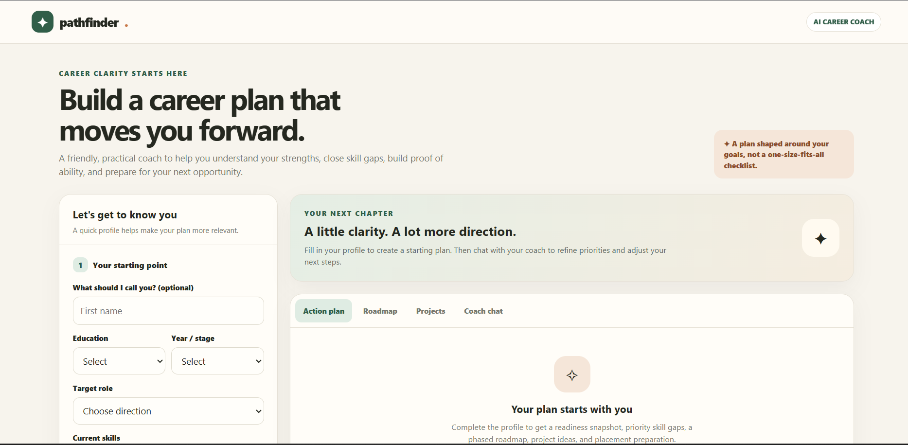
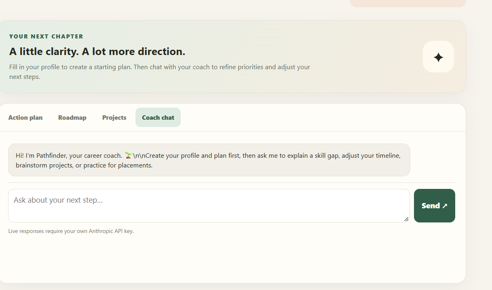

# Day 40 — AI Assistant Builder 🚀

## Pathfinder — AI Career Coach

A friendly AI career coach designed to help students identify skill gaps, explore career opportunities, and build a personalized action plan.

### ✨ Features
- Guided student profile form
- Personalized career guidance
- Interactive AI coach chat
- Career roadmap and project suggestions
- Responsive user interface

## 📸 Screenshots

### 1. Pathfinder Dashboard

### 2. AI Career Coach Chat

### 3. How It Was Built

## 🛠️ Tech Stack
- HTML
- CSS
- JavaScript
- Anthropic API

## 🔐 Security Note
The application accepts an API key at runtime. For public deployment, use a secure backend proxy instead of exposing API keys in the browser.

## 🎯 Challenge
**ABTalks — 60 Days Claude Challenge | Day 40**

Building practical AI experiences, one day at a time.
