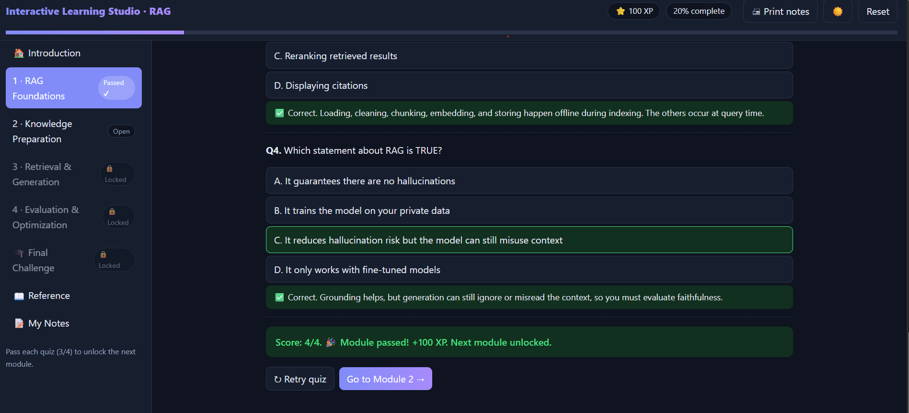
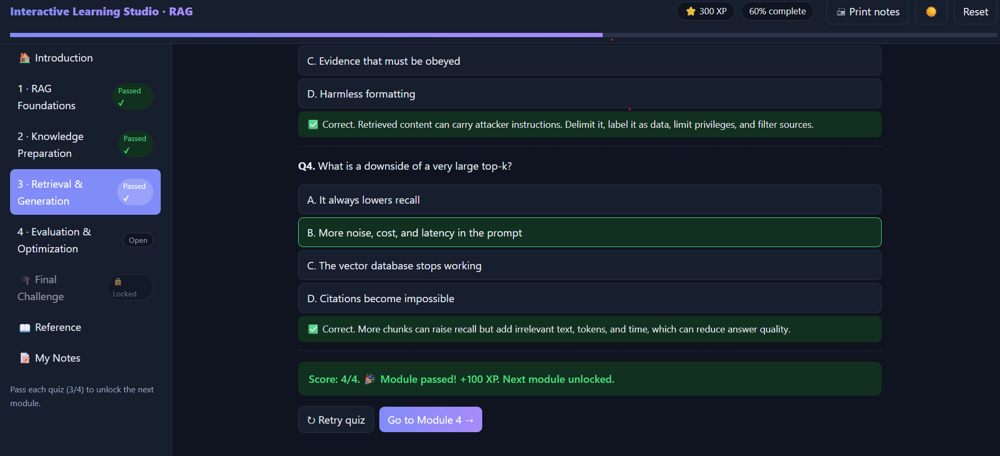
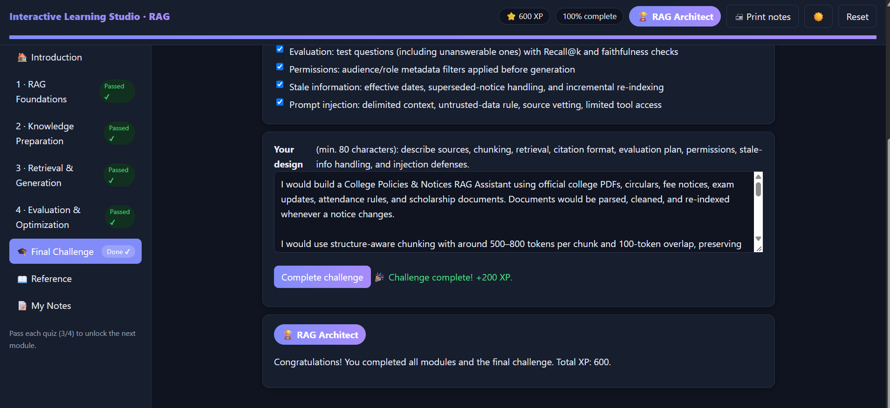

# Day 41 — Interactive Learning Studio: RAG

**ABTalks 60 Days Claude Challenge**

Built an interactive, single-file HTML learning app to understand **Retrieval-Augmented Generation (RAG)**, from fundamentals to production-level design.

## 📸 Screenshots

### 1. Learning Studio Dashboard

### 2. RAG Module & Quiz

### 3. Interactive Experiments

### 4. Final Challenge & Completion

## 📚 Learning Modules

1. **RAG Fundamentals** — How RAG works and why external knowledge is useful.
2. **Document Processing & Indexing** — Chunking, overlap, embeddings, vector databases, and metadata.
3. **Retrieval & Generation** — Hybrid search, top-k, reranking, grounding, and prompt injection.
4. **Evaluation & Production RAG** — Precision@k, Recall@k, faithfulness, permissions, and outdated information.

## ⚙️ Features

- Four modules with 16 multiple-choice quiz questions.
- Automatic scoring, answer explanations, and retries.
- A passing requirement of 3/4 to unlock the next module.
- Progress tracking and XP rewards.
- Chunk-size and overlap experiment.
- Interactive keyword, semantic, and hybrid retrieval lab.
- Precision@k and Recall@k calculator.
- Failure-diagnosis exercises.
- Final College Policies & Notices Assistant design challenge.
- Dark/light theme, saved notes, and browser-based progress persistence.
- Printable learning notes and reference resources.

## 🛠️ Tech Stack

- HTML5
- CSS3
- Vanilla JavaScript
- Browser LocalStorage

## 🚀 How to Run

1. Download `interactive-learning-studio-rag.html`.
2. Open the file in a modern browser such as Chrome.
3. Explore the modules, complete the quizzes, and try the interactive labs.
4. Complete the final challenge.

The app is designed to run locally without external libraries or API keys.

## 🎯 What I Learned

This challenge helped me understand the complete RAG pipeline, from document ingestion and chunking to retrieval, grounded generation, evaluation, and security. It also highlighted why citations, access control, and outdated-document handling are essential for reliable AI applications.

---

**Challenge:** ABTalks 60 Days Claude Challenge  
**Day:** 41  
**Project:** Interactive Learning Studio — RAG
