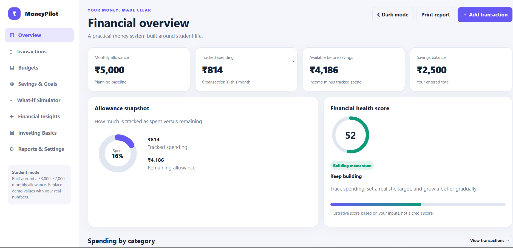
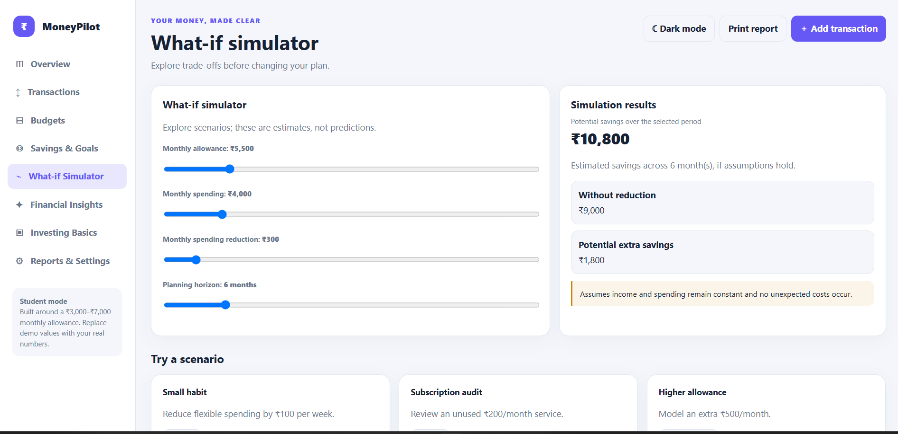

# 💰 Day 42 — Personal Financial Command Center

> **ABTalks Challenge | Day 42**  
> A student-focused personal finance dashboard to track expenses, manage budgets, monitor savings, and build better financial habits.

## 📌 Project Overview

The **Personal Financial Command Center** is a browser-based finance management application designed with students in mind. It helps users understand where their money goes, set monthly budgets, track savings goals, and explore different financial scenarios.

The project focuses on making personal finance easier to understand through an interactive dashboard and beginner-friendly financial insights.

## ✨ Key Features

- 📊 **Financial Overview** — Monitor income, expenses, savings, and budget status.
- 💸 **Transaction Tracker** — Record and organize daily income and expenses.
- 🗂️ **Budget Management** — Set category-wise budgets and monitor spending.
- 🎯 **Savings Goals** — Track progress toward emergency funds, college expenses, and planned purchases.
- 🔮 **What-If Simulator** — Explore how different income, expense, and savings assumptions affect your budget.
- 🧠 **Financial Insights** — View rule-based insights based on recorded financial activity.
- 📈 **Financial Health Score** — Get an indicative view of your financial habits.
- 📚 **Investing Basics** — Explore foundational investing concepts before investing real money.
- 🌙 **Dark Mode** — Switch between light and dark themes.
- 💾 **Local Storage** — Persist application data in your browser.
- 📤 **Backup and Restore** — Export and import financial data in JSON format.
- 🖨️ **Print Support** — Print a view of your financial dashboard.

## 🖼️ Screenshots

### 1. Financial Overview

View your financial summary, monthly expenses, savings, and recent activity.

### 2. Transactions and Budget Management

Organize transactions and review your spending across different categories.

### 3. What-If Financial Simulator

Explore hypothetical monthly budgets and compare possible savings outcomes.

## 🛠️ Tech Stack

| Technology | Purpose |
|---|---|
| HTML5 | Application structure |
| CSS3 | Styling and responsive layout |
| JavaScript | Interactive features and calculations |
| Browser Local Storage | Saving data locally |

## 🚀 Getting Started

1. Clone or download this repository.
2. Open `Personal_Financial_Command_Center.html` in a modern web browser.
3. Add transactions, configure budgets, and create savings goals.
4. Explore the dashboard and financial simulator.

No backend server or external dependencies are required for the standalone HTML application.

## 📚 What I Learned

- Building an interactive web application with HTML, CSS, and JavaScript.
- Managing client-side data using browser Local Storage.
- Designing transaction tracking and budget management workflows.
- Implementing rule-based insights and financial scenario calculations.
- Creating a student-focused dashboard with a responsive interface.
- Providing data backup and restore functionality.

## 🔮 Future Improvements

- Backend integration and secure user authentication.
- Database-based financial record management.
- Interactive spending charts and monthly reports.
- More personalized budgeting recommendations.
- Optional AI-powered financial insights.

## ⚠️ Disclaimer

This project is intended for educational purposes and personal budgeting. Financial health scores and insights are indicative, not professional financial advice. Investing information is educational and does not guarantee returns.

---

**Built as part of the ABTalks Challenge — Day 42.** 🚀

*Track smarter. Save consistently. Build better financial habits.*
