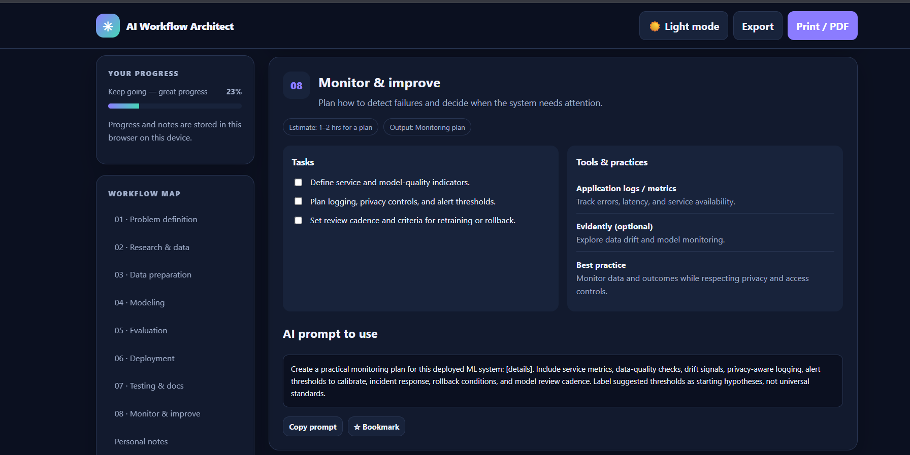

# 🚀 Day 43/60 — AI Workflow Architect

An interactive AI/ML engineering workflow dashboard built as part of the **ABTalks × Claude 60 Days Challenge**.

## 📸 Project Screenshots

### 1. Dashboard Overview

### 2. AI/ML Workflow Stages

## ✨ Key Features

- 🧠 **8-Stage AI/ML Workflow** — From problem definition to monitoring and continuous improvement.
- ✅ **Task Progress Tracking** — Track completed tasks across the workflow.
- 🤖 **AI Prompt Library** — Ready-to-use prompts for each development stage.
- 🛠️ **Tool Recommendations** — Discover useful tools for data preparation, modeling, evaluation, deployment, and testing.
- 🔖 **Bookmarks** — Save important workflow stages.
- 📝 **Personal Notes** — Record decisions, experiments, and next steps.
- 🌙 **Dark and Light Modes** — Switch between themes.
- 💾 **Local Storage** — Preserve progress and notes in the browser.
- 📤 **JSON Export** — Export a backup of your workflow data.
- 🖨️ **Print Support** — Print the workflow or save it as a PDF.
- 📱 **Responsive Design** — Adapted for desktop and mobile screens.

## 🔄 Workflow Stages

1. Define the Problem
2. Research and Source Data
3. Prepare the Data
4. Build a Baseline and Train Models
5. Evaluate and Explain
6. Deploy and Integrate
7. Test and Document
8. Monitor and Improve

## 🛠️ Tech Stack

- HTML5
- CSS3
- JavaScript
- Browser Local Storage

## ▶️ How to Run

1. Download `day43_ai_workflow_architect.html`.
2. Open the file in a modern web browser.
3. Navigate through the eight workflow stages.
4. Mark tasks as completed, save notes, bookmark stages, and export your progress.

No backend or installation is required.

## 💡 Key Learning

This project helped me organize the AI/ML development lifecycle into practical stages, from defining a problem and preparing data to model evaluation, deployment, and monitoring.

It reinforced the importance of reproducibility, meaningful evaluation, documentation, and continuous improvement when building AI-powered applications.

## 🎯 Challenge

**ABTalks × Claude — 60 Days Challenge**

Learning by building, one project at a time.

#ABTalks #Claude #60DaysOfClaudeChallenge #AI #MachineLearning #ArtificialIntelligence #WebDevelopment #BuildInPublic
