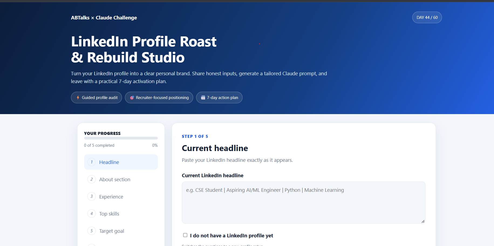
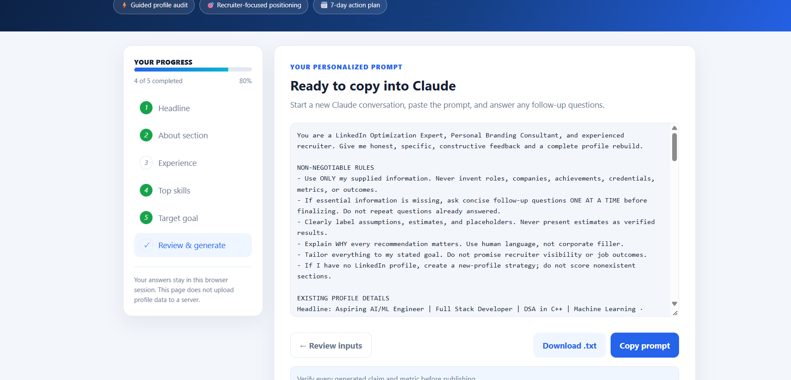

# Day 44 — LinkedIn Profile Roast & Rebuild Studio 🚀

### ABTalks × Claude — 60 Days Challenge

For Day 44, I built an interactive **LinkedIn Profile Roast & Rebuild Studio** using HTML, CSS, and JavaScript.

The goal of this application is to help users improve their LinkedIn personal branding through structured profile analysis, recruiter-focused feedback, and actionable career recommendations.

## 🖥️ Application Screenshots

### 1. Application Overview

### 2. Experience Questionnaire

## ✨ Key Features

- **Guided Profile Questionnaire:** Collects headline, About section, experience, skills, and career goals.
- **New Profile Support:** Provides a separate input flow for users who don't have a LinkedIn profile yet.
- **Progress Tracking:** Tracks completion of the five information-gathering steps.
- **Input Review:** Allows users to review their information before generating the prompt.
- **Personalized Claude Prompt:** Generates a detailed prompt based on the user's responses.
- **Copy Prompt:** Easily copies the generated prompt for use in Claude.
- **Download Prompt:** Exports the generated prompt as a TXT file.

## 🎯 What the Generated Analysis Covers

1. **Profile Roast:** Section-wise scoring and recruiter-focused feedback.
2. **Profile Rebuild:** Three headline options and an improved About section.
3. **Experience Optimization:** Before-and-after bullet rewrites.
4. **Skills Recommendations:** Top skills, keywords, and pinned skills.
5. **Before vs After Scorecard:** Projected profile improvement scores.
6. **7-Day LinkedIn Activation Plan:** Daily actions to improve profile engagement and networking.
7. **Shareable Summary Card:** A concise summary of profile improvements.

## 🛠️ Tech Stack

- HTML5
- CSS3
- JavaScript
- Browser DOM API
- Clipboard API
- Blob API for TXT export

## ▶️ How to Run

1. Download `day44_linkedin_profile_roast_rebuild.html`.
2. Open the file in any modern web browser.
3. Complete the five-step questionnaire.
4. Review your information.
5. Generate and copy your personalized Claude prompt.
6. Paste it into a new Claude conversation to receive the complete LinkedIn optimization analysis.

## 📚 What I Learned

- How to structure a multi-step interactive web application.
- How to manage form inputs and application state using JavaScript.
- How to generate dynamic prompts from user-provided information.
- How to use browser APIs for clipboard copying and file downloads.
- How AI can support personal branding and career development workflows.

## 💡 Key Takeaway

A LinkedIn profile should communicate more than just education and skills. It should clearly show your identity, projects, capabilities, and the value you can bring.

This project helped me explore how AI-powered workflows can make career development more structured and actionable.

---

**Day 44 completed! Building, learning, and improving one day at a time. 🚀**

#ABTalks #Claude #60DaysOfClaudeChallenge #LinkedInOptimization #PersonalBranding #ArtificialIntelligence #WebDevelopment #JavaScript #BuildInPublic
