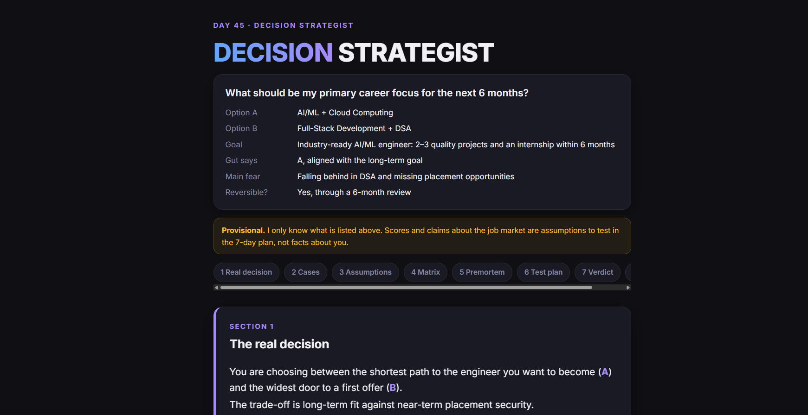
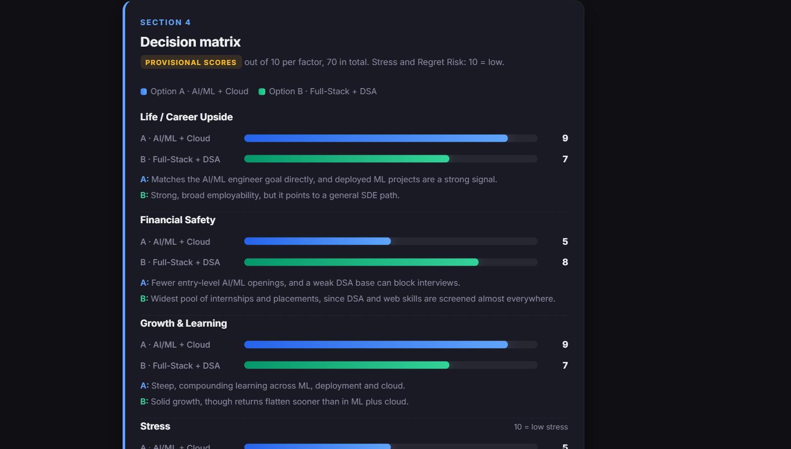

# Day 45 — Decision Strategist 🧠

**ABTalks × Claude 60-Day Challenge**

## 📌 Project Overview

For Day 45, I built a **Decision Strategist** — an interactive decision-support dashboard that helps users evaluate difficult choices, challenge assumptions, identify cognitive biases and make structured decisions.

The project compares two career paths:
- **Option A:** AI/ML + Cloud Computing
- **Option B:** Full-Stack Development + DSA

The report recommends AI/ML + Cloud as the primary direction while maintaining DSA and software-development fundamentals.

## 🖥️ Project Screenshots

### Screenshot 1 — Decision Dashboard

### Screenshot 2 — Decision Matrix & Verdict

## ✨ Key Features

- Real Decision Analysis
- Case for Each Option
- Assumption Buster and Cognitive Bias Detection
- Interactive Decision Matrix with animated score bars
- 12-Month Premortem Analysis
- 7-Day Decision Test Plan
- Final Verdict with reasoning
- Three Shareable Summary Cards

## 🛠️ Tech Stack

- HTML5
- CSS3
- JavaScript
- Google Fonts — Inter

## 📚 Key Learnings

1. **Decision Intelligence:** Breaking complex decisions into manageable parts.
2. **Bias Detection:** Recognizing cognitive biases that influence choices.
3. **Decision Matrix:** Comparing alternatives using structured scoring.
4. **Premortem Analysis:** Identifying possible failure points before making a decision.
5. **Interactive Web Development:** Building a complete responsive dashboard using HTML, CSS and JavaScript.

## 💡 Key Takeaway

A good decision isn't about eliminating uncertainty. It's about understanding the trade-offs, challenging your assumptions and choosing a direction based on evidence.

**Day 45/60 completed!** 🚀

---

**Built with Claude AI | ABTalks 60-Day Challenge**

#ABTalks #ClaudeChallenge #60DaysOfClaude #DecisionMaking #DecisionIntelligence #HTML #CSS #JavaScript #BuildInPublic
