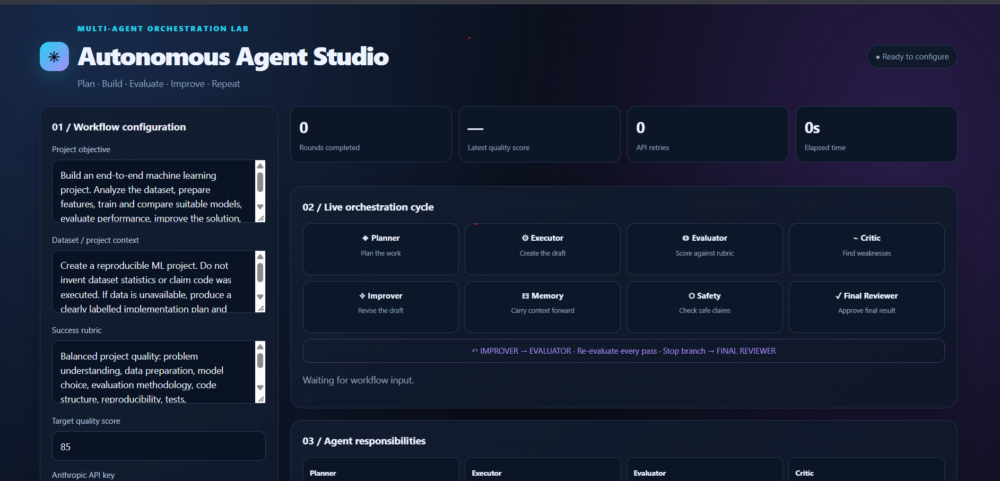
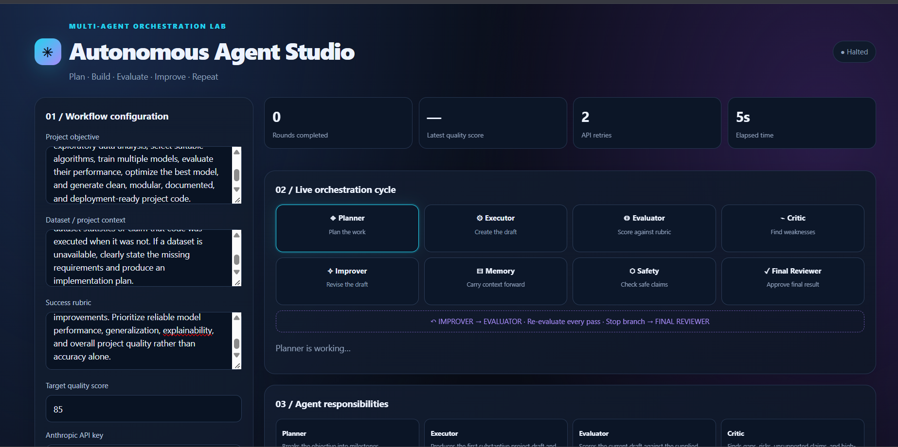

# Day 46/60 – Autonomous Agent Studio 🤖

## 🎯 Objective
Designed and developed an **Autonomous Agent Studio** that demonstrates how multiple AI agents can collaborate to plan, evaluate, improve, and review an AI/ML project through an iterative workflow.

## 🧠 Agent Architecture
The system is designed around eight specialized agents:

1. **Planner Agent** – Creates the project execution plan.
2. **Executor Agent** – Prepares the project implementation.
3. **Evaluator Agent** – Evaluates project quality.
4. **Critic Agent** – Identifies weaknesses and improvement areas.
5. **Improver Agent** – Suggests improvements based on feedback.
6. **Memory Manager Agent** – Maintains context across iterations.
7. **Safety Monitor Agent** – Monitors execution and safety.
8. **Final Reviewer Agent** – Reviews the final output.

## ⚙️ Workflow
- Define the project objective and evaluation criteria.
- Plan and prepare the project workflow.
- Evaluate the output and identify weaknesses.
- Improve the output using feedback.
- Maintain memory across iterations.
- Stop when the target quality score is reached, progress plateaus, or the iteration limit is reached.

## 🛑 Stopping Conditions
- Target quality score: **85/100**
- Stop if progress plateaus for two consecutive rounds.
- Apply a maximum iteration limit as a safety measure.

## 🖥️ Project Screenshots

### Screenshot 1 – Agent Dashboard

### Screenshot 2 – Execution Status

## 🛠️ Technology Stack
- HTML
- CSS
- JavaScript
- Anthropic Claude API

## ⚠️ Execution Note
The dashboard was successfully loaded, but the live Claude API execution could not proceed because the Anthropic API account had insufficient credits. No live agent iterations were completed in this run.

The project demonstrates the intended multi-agent orchestration design; live execution requires sufficient API credits.

## 📌 Key Learning
Learned how to structure a multi-agent workflow, assign specialized responsibilities, maintain iteration memory, evaluate output quality, and define autonomous stopping conditions.

**Day 46/60 – Completed the Autonomous Agent Studio design!** 🚀

#60DaysOfClaude #ABTalks #AI #AIAgents #AgenticAI #MachineLearning #Claude
