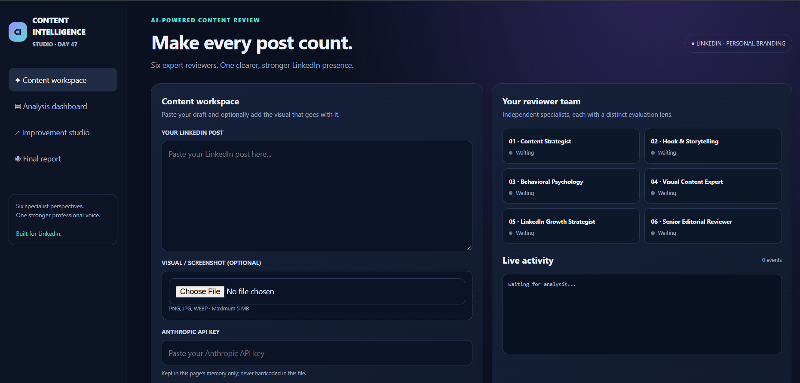

# Day 47 – Content Intelligence Studio

## Project Overview

**Content Intelligence Studio** is an AI-powered content analysis tool designed to review and improve LinkedIn posts. It uses six specialized AI reviewers to evaluate content from different professional perspectives and provide actionable feedback.

The goal is to help creators improve their personal branding, storytelling, engagement, and overall content quality.

## Features

- **Six AI Reviewers:** Content Strategist, Hook & Storytelling Expert, Behavioral Psychology Expert, Visual Content Expert, LinkedIn Growth Strategist, and Senior Editorial Reviewer.
- **Content Analysis:** Review LinkedIn posts using text and uploaded images or screenshots.
- **Detailed Feedback:** Identify strengths, weaknesses, missed opportunities, and areas for improvement.
- **Content Scoring:** Evaluate content quality through reviewer scores.
- **AI Improvements:** Generate an improved LinkedIn post, alternative hooks, headlines, and calls to action.
- **Publishing Checklist:** Provide suggestions before publishing.
- **Before & After Comparison:** Compare the original content with the improved version.
- **Final Report:** Generate a consolidated analysis report that can be downloaded.

## Dashboard Screenshot

## Tech Stack

- HTML5
- CSS3
- Vanilla JavaScript
- Anthropic Claude API

## How It Works

1. Enter your Anthropic API key.
2. Add the LinkedIn post you want to analyze.
3. Upload an optional image or screenshot.
4. Start the content analysis.
5. Six specialized AI reviewers evaluate the content sequentially.
6. Review the feedback, scores, and improvement suggestions.
7. Generate and download the final report.

## Setup Instructions

1. Download or clone the project repository.
2. Open `index.html` in a modern web browser.
3. Enter a valid Anthropic API key.
4. Add your content and optionally upload an image.
5. Run the analysis to receive AI-generated feedback.

**Note:** API access requires a valid Anthropic API key and sufficient API credits. The application currently uses a browser-based API integration. For production use, API credentials should be handled securely through a backend rather than exposed in the browser.

## Learning Outcomes

- Working with the Anthropic Claude API.
- Building AI-powered applications using Vanilla JavaScript.
- Designing multi-agent review workflows.
- Handling text and image inputs.
- Creating interactive dashboards and reports.
- Understanding AI-assisted content evaluation and improvement.

## Conclusion

Day 47 focused on building an AI-powered Content Intelligence Studio that brings multiple expert perspectives into one platform. It demonstrates how AI can help creators analyze, refine, and improve professional content before publishing.

**Challenge:** 60 Days Claude Challenge  
**Day:** 47 – Content Intelligence Studio
