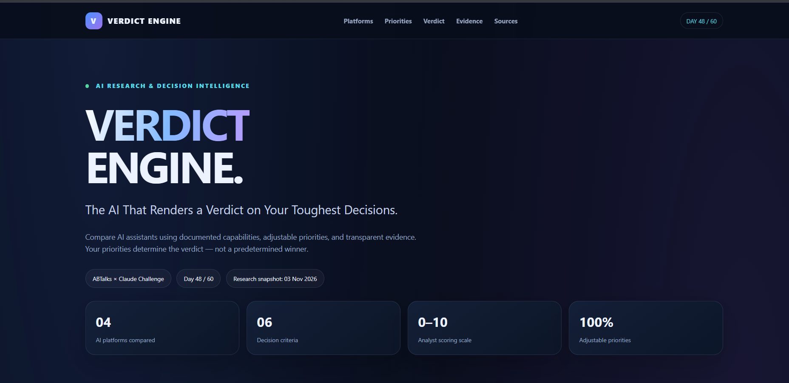

# Day 48 – The Verdict Engine ⚖️

## AI Tools & Platforms Comparison

Built **The Verdict Engine**, an interactive comparison dashboard that helps students and developers evaluate popular AI assistants: **Claude, ChatGPT, Gemini, and Perplexity**.

Instead of relying on a fixed ranking, the application allows users to adjust evaluation criteria weights and see rankings update dynamically.

## Features

- Compare Claude, ChatGPT, Gemini, and Perplexity.
- Evaluate six criteria:
  - Coding Performance & Debugging
  - Research Quality & Source Accuracy
  - Learning Support & Explanation Quality
  - Writing & Productivity Capabilities
  - Pricing & Free-Tier Limitations
  - Context Window, Speed & Availability
- Adjustable criteria weights.
- Live weighted scores and dynamic rankings.
- Research references and visible citations.
- Clear distinction between sourced information, estimates, and synthetic placeholders.
- Responsive dashboard with an expandable research methodology section.

## Screenshot

### Verdict Engine – AI Comparison Dashboard

## Tech Stack

- HTML
- CSS
- JavaScript

## Key Learning

This challenge helped me explore how to turn AI research into an interactive decision-support tool. I focused on transparent comparisons, customizable evaluation criteria, and dynamic ranking rather than presenting a fixed verdict.

## Project Files

- `index.html` – Complete Verdict Engine application.
- `day48_ss1_verdict_engine_dashboard.png` – Application screenshot.

---

**Day 48 completed – 60 Days Claude Challenge 🚀**
